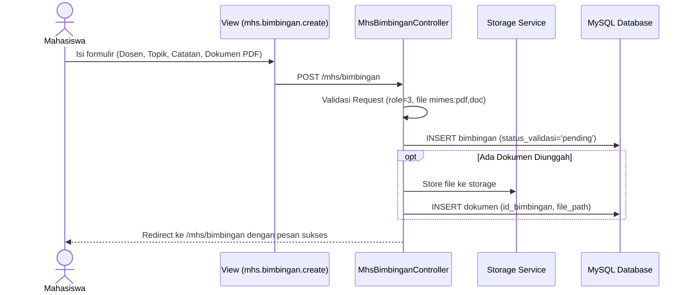
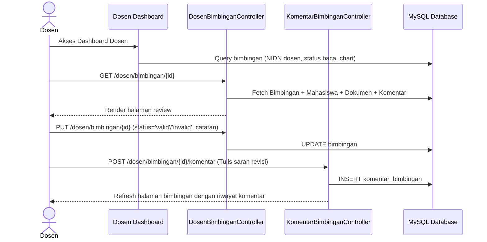

# SYSTEM ARCHITECTURE DOCUMENTATION

**Proyek:** Sistem Informasi Manajemen Bimbingan Akademik (SIM Bimbingan - UBSI)  
**Versi:** 1.0.0  
**Tanggal:** 21 Oktober 2026  
**Penulis:** Hermes Agent (Software Architect)  

---

## 1. Arsitektur Tingkat Tinggi (High-Level Architecture)

SIM Bimbingan mengadopsi pola arsitektur **Monolith MVC (Model-View-Controller)** berbasis framework **Laravel 11**, dengan antarmuka dinamis bertenaga **Blade Templates**, **Tailwind CSS**, dan **Alpine.js**.

```
┌─────────────────────────────────────────────────────────────┐
│                       Client Browser                        │
│               (Desktop & Mobile Responsive)                 │
└──────────────────────────────┬──────────────────────────────┘
                               │ HTTP / HTTPS
                               ▼
┌─────────────────────────────────────────────────────────────┐
│                    Web Server & Routing                     │
│                (public/index.php, web.php)                  │
└──────────────────────────────┬──────────────────────────────┘
                               │
            ┌──────────────────┴──────────────────┐
            ▼                                     ▼
┌───────────────────────┐             ┌───────────────────────┐
│ Global & Web          │             │ Role Middleware       │
│ Middleware (CSRF,     │             │ (Admin=1, Dosen=2,    │
│ Sessions, Cookies)    │             │  Mahasiswa=3)         │
└───────────┬───────────┘             └───────────┬───────────┘
            └──────────────────┬──────────────────┘
                               │
                               ▼
┌─────────────────────────────────────────────────────────────┐
│                     Controller Layer                        │
│  - Auth\AuthController        - Dosen\DosenBimbingan        │
│  - Mhs\MhsBimbingan           - Admin\UserController        │
│  - Dosen\DashboardDosen       - Admin\BimbinganController   │
└──────────────────────────────┬──────────────────────────────┘
                               │
            ┌──────────────────┴──────────────────┐
            ▼                                     ▼
┌───────────────────────┐             ┌───────────────────────┐
│  Presentation Layer   │             │   Domain Data Layer   │
│  (Blade + Alpine.js   │             │   (Eloquent Models &  │
│   + Chart.js)         │             │    Database Migrations│
└───────────────────────┘             └───────────┬───────────┘
                                                  │
                                                  ▼
                                      ┌───────────────────────┐
                                      │      Storage & DB     │
                                      │  - MySQL / SQLite DB  │
                                      │  - Storage Disk Public│
                                      └───────────────────────┘
```

---

## 2. Diagram Alur Utama (Mermaid Sequence Diagrams)

### 2.1 Alur Pengajuan Bimbingan oleh Mahasiswa



### 2.2 Alur Validasi dan Review oleh Dosen



---

## 3. Strategi Penyimpanan File & Dokumen (Storage Architecture)

1. **Penyimpanan Dokumen Bimbingan:**
   - Disimpan pada storage disk yang terdaftar di `config/filesystems.php`.
   - Menggunakan accessor `getPublicUrlAttribute()` di model `Dokumen` yang menjamin link download tetap valid untuk berkas lama (`doc/...`) maupun berkas baru (`storage/...`).
   - Symbolic link aktif: `public/storage` mengarah ke `storage/app/public`.
2. **Penyimpanan Foto Profil (Avatar):**
   - Disimpan di `public/profile/{role}/`.
   - Model `User` menyediakan atribut kanonis `avatar_url` dengan fallback aman ke `img/default-avatar.png` untuk mencegah tampilan broken image.

---

## 4. Keamanan & RBAC (Role-Based Access Control)

- **Role ID Definition:**
  - `1`: Administrator
  - `2`: Dosen
  - `3`: Mahasiswa
- **Middleware Guard:**
  - `auth`: Memastikan request berasal dari sesi yang telah login.
  - `role:{id}`: Mengevaluasi integer role pengguna terhadap role target. Jika tidak cocok, pengguna dialihkan otomatis ke dashboard perannya masing-masing.
- **Integritas Transaksi:** Operasi multi-tabel (pembuatan user + profil mahasiswa/dosen) dijamin atomis melalui `DB::transaction(...)`.
