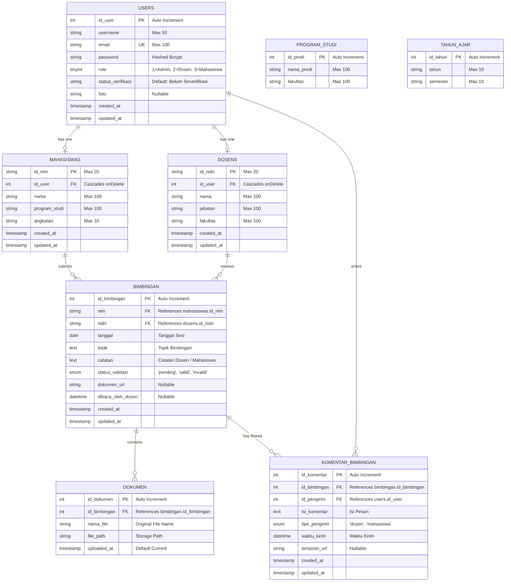

# ENTITY RELATIONSHIP DIAGRAM (ERD) & DATA DICTIONARY

**Proyek:** Sistem Informasi Manajemen Bimbingan Akademik (SIM Bimbingan - UBSI)  
**Tanggal:** 21 Oktober 2026  
**Auditor:** Hermes Agent (Software Architect & Database Engineer)  

---

## 1. Diagram ERD (Mermaid)

---

## 2. Kamus Data (Data Dictionary)

### 2.1 Tabel `users`
Tabel autentikasi utama untuk semua peran pengguna sistem.

| Kolom | Tipe Data | Nullable | Default | Keterangan / Constraint |
|---|---|---|---|---|
| `id_user` | `INT UNSIGNED` | No | AUTO_INCREMENT | Primary Key |
| `username` | `VARCHAR(50)` | No | - | Username / NIM / NIDN |
| `email` | `VARCHAR(100)` | No | - | Unique Key, alamat email pengguna |
| `password` | `VARCHAR(255)` | No | - | Kata sandi hash Bcrypt |
| `role` | `TINYINT` | No | - | `1` = Admin, `2` = Dosen, `3` = Mahasiswa |
| `status_verifikasi` | `VARCHAR(255)` | No | 'Belum Terverifikasi' | Status verifikasi akun |
| `foto` | `VARCHAR(255)` | Yes | NULL | Nama file avatar pengguna |
| `created_at` | `TIMESTAMP` | Yes | NULL | Tanggal pembuatan |
| `updated_at` | `TIMESTAMP` | Yes | NULL | Tanggal pembaruan |

---

### 2.2 Tabel `mahasiswas`
Menyimpan profil detail pengguna dengan peran Mahasiswa.

| Kolom | Tipe Data | Nullable | Default | Keterangan / Constraint |
|---|---|---|---|---|
| `id_nim` | `VARCHAR(20)` | No | - | Primary Key (Nomor Induk Mahasiswa) |
| `id_user` | `INT UNSIGNED` | No | - | Foreign Key -> `users.id_user` ON DELETE CASCADE |
| `nama` | `VARCHAR(100)` | No | - | Nama lengkap mahasiswa |
| `program_studi` | `VARCHAR(100)` | No | - | Nama program studi |
| `angkatan` | `VARCHAR(10)` | No | - | Tahun angkatan masuk |
| `created_at` | `TIMESTAMP` | Yes | NULL | Timestamp |
| `updated_at` | `TIMESTAMP` | Yes | NULL | Timestamp |

---

### 2.3 Tabel `dosens`
Menyimpan profil detail pengguna dengan peran Dosen Pembimbing.

| Kolom | Tipe Data | Nullable | Default | Keterangan / Constraint |
|---|---|---|---|---|
| `id_nidn` | `VARCHAR(20)` | No | - | Primary Key (Nomor Induk Dosen Nasional) |
| `id_user` | `INT UNSIGNED` | No | - | Foreign Key -> `users.id_user` ON DELETE CASCADE |
| `nama` | `VARCHAR(100)` | No | - | Nama lengkap beserta gelar dosen |
| `jabatan` | `VARCHAR(100)` | No | - | Jabatan akademik / fungsional (Lektor, Asisten Ahli, dll) |
| `fakultas` | `VARCHAR(100)` | No | - | Fakultas homebase dosen |
| `created_at` | `TIMESTAMP` | Yes | NULL | Timestamp |
| `updated_at` | `TIMESTAMP` | Yes | NULL | Timestamp |

---

### 2.4 Tabel `bimbingan`
Menyimpan data catatan sesi permohonan bimbingan antara mahasiswa dan dosen.

| Kolom | Tipe Data | Nullable | Default | Keterangan / Constraint |
|---|---|---|---|---|
| `id_bimbingan` | `INT UNSIGNED` | No | AUTO_INCREMENT | Primary Key |
| `nim` | `VARCHAR(20)` | No | - | Foreign Key -> `mahasiswas.id_nim` ON DELETE CASCADE |
| `nidn` | `VARCHAR(20)` | No | - | Foreign Key -> `dosens.id_nidn` ON DELETE CASCADE |
| `tanggal` | `DATE` | No | - | Tanggal sesi bimbingan |
| `topik` | `TEXT` | No | - | Topik bimbingan / judul bab skripsi |
| `catatan` | `TEXT` | Yes | NULL | Catatan deskripsi pengajuan / review dosen |
| `status_validasi` | `ENUM('pending','valid','invalid')` | No | 'pending' | Status persetujuan dosen |
| `dokumen_url` | `VARCHAR(255)` | Yes | NULL | URL dokumen legacy (opsional) |
| `dibaca_oleh_dosen` | `DATETIME` | Yes | NULL | Timestamp saat dosen membaca pengajuan |
| `created_at` | `TIMESTAMP` | Yes | NULL | Timestamp |
| `updated_at` | `TIMESTAMP` | Yes | NULL | Timestamp |

---

### 2.5 Tabel `dokumen`
Menyimpan berkas lampiran pendukung (draft, revisi, artikel) untuk setiap sesi bimbingan.

| Kolom | Tipe Data | Nullable | Default | Keterangan / Constraint |
|---|---|---|---|---|
| `id_dokumen` | `INT UNSIGNED` | No | AUTO_INCREMENT | Primary Key |
| `id_bimbingan` | `INT UNSIGNED` | No | - | Foreign Key -> `bimbingan.id_bimbingan` ON DELETE CASCADE |
| `nama_file` | `VARCHAR(255)` | No | - | Nama asli file saat diunggah |
| `file_path` | `VARCHAR(255)` | No | - | Jalur relatif file pada storage |
| `uploaded_at` | `TIMESTAMP` | No | CURRENT_TIMESTAMP | Waktu berkas diunggah |

---

### 2.6 Tabel `komentar_bimbingan`
Menyimpan utas obrolan/diskusi timbal-balik pada suatu bimbingan.

| Kolom | Tipe Data | Nullable | Default | Keterangan / Constraint |
|---|---|---|---|---|
| `id_komentar` | `INT UNSIGNED` | No | AUTO_INCREMENT | Primary Key |
| `id_bimbingan` | `INT UNSIGNED` | No | - | Foreign Key -> `bimbingan.id_bimbingan` ON DELETE CASCADE |
| `id_pengirim` | `INT UNSIGNED` | No | - | Foreign Key -> `users.id_user` ON DELETE CASCADE |
| `isi_komentar` | `TEXT` | No | - | Konten pesan / saran revisi |
| `tipe_pengirim` | `ENUM('dosen','mahasiswa')` | No | - | Peran pengirim komentar |
| `waktu_kirim` | `DATETIME` | No | - | Waktu pesan dikirimkan |
| `lampiran_url` | `VARCHAR(255)` | Yes | NULL | Tautan opsional pada komentar |
| `created_at` | `TIMESTAMP` | Yes | NULL | Timestamp |
| `updated_at` | `TIMESTAMP` | Yes | NULL | Timestamp |

---

### 2.7 Tabel Master: `program_studi` & `tahun_ajar`
- **`program_studi`**: `id_prodi` (PK, Int Auto), `nama_prodi` (Varchar 100), `fakultas` (Varchar 100).
- **`tahun_ajar`**: `id_tahun` (PK, Int Auto), `tahun` (Varchar 10), `semester` (Varchar 10).
